  

  Android / Flutter / React Native を中心に、何でも楽しく作っています。

  
  

## Tech Stack

## Stats

  
  

## Contributions

  

  

## Trophies

  

## Projects

<!-- 後で追加 -->

## Contact

<!-- 後で追加(X / Qiita / Zenn など) -->
